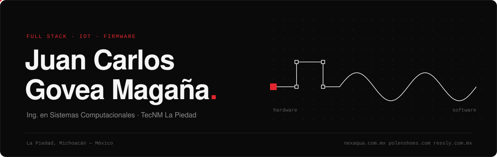
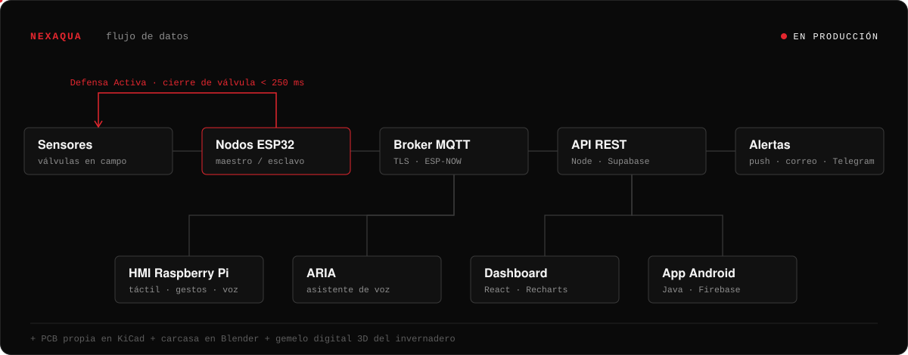
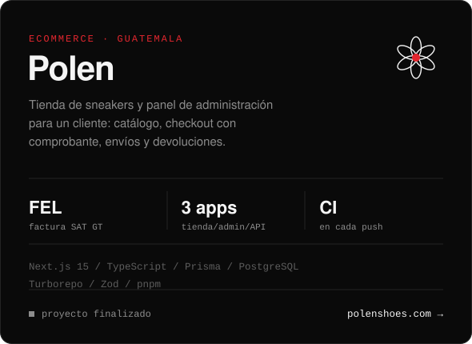
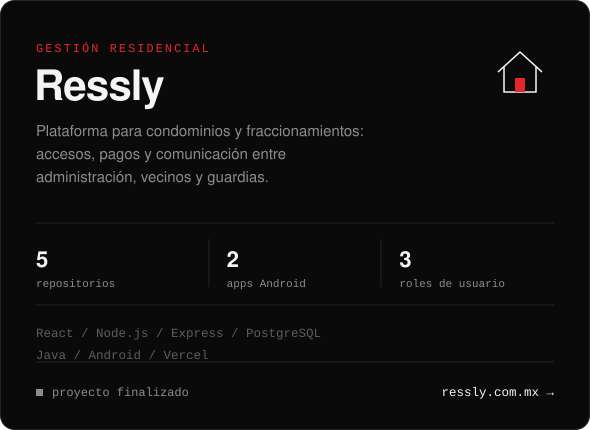
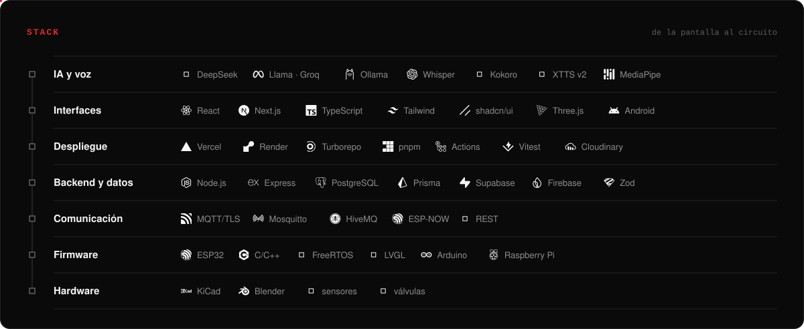
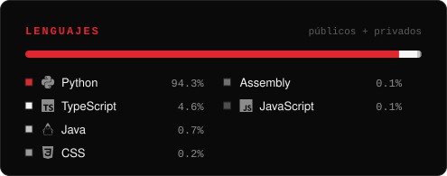

 

## Sobre mí

Estudio Ingeniería en Sistemas Computacionales en el TecNM La Piedad. Trabajo en todas las capas de un sistema: diseño la PCB, escribo el firmware y construyo la API, el dashboard, la app móvil y el asistente de voz que los conecta.

Ahora mismo estoy dedicado a **NexAquA**, que está en producción y compite en la etapa nacional de InnovaTecNM. Antes entregué **Polen** y **Ressly**, ambos terminados.

## NexAquA

Sistema IoT de monitoreo hídrico para MiPyMEs agroindustriales. Si un nodo detecta una fuga, la *Defensa Activa* cierra la válvula en menos de 250 ms sin depender de la nube.

| | Repositorio | Qué hace | Stack |
|:-:|:--|:--|:--|
|  | [Firmware ESP32](https://github.com/JCarlos-GM/NexAquA-ESP32-Firmware) | Nodos maestro/esclavo con pantalla TFT, ESP-NOW, MQTT/TLS y Defensa Activa | C++ · FreeRTOS · LVGL |
|  | [HMI Raspberry Pi](https://github.com/JCarlos-GM/NexAquA-RPi) | Terminal táctil de operador con control por gestos y voz | React 19 · TypeScript · MediaPipe |
|  | [API REST](https://github.com/JCarlos-GM/NexAquA-API) | Nodos, eventos, reportes PDF, notificaciones y chatbot con *tool-calling* | Node · Express · Supabase |
|  | [Dashboard](https://github.com/JCarlos-GM/NexAquA-Dashboard) | Panel de gerencia: widgets, mapas, ROI y exportación PDF/Excel | React · shadcn/ui · Recharts |
|  | [App Android](https://github.com/JCarlos-GM/NexAquA-Android-App) | Operación en campo: alertas, calibración y aprovisionamiento por QR | Java · Retrofit · Firebase |
|  | [ARIA](https://github.com/JCarlos-GM/NexAquA-ARIA) | Asistente de voz con el contexto de la empresa, procesamiento local | Python · faster-whisper · Ollama |

## Proyectos entregados

  
  

## Otros proyectos

| | Proyecto | Descripción | Stack |
|:-:|:--|:--|:--|
|  | [3D Visualizer](https://github.com/JCarlos-GM/NexAquA-3D-Visualizer) | Gemelo digital del invernadero de NexAquA con *GPU instancing* | React Three Fiber · Blender |
|  | [nexaqua-bridge](https://github.com/JCarlos-GM/nexaqua-bridge) | Puente MQTT → Firebase Cloud Messaging para alertas push | Node · HiveMQ · FCM |
|  | [FluxSolver](https://flux-solver.vercel.app) | Jacobi y Gauss-Seidel con entrada por voz, OCR y vista 3D | TypeScript · Tesseract.js |
|  | [PseudoHub](https://pseudo-hub.vercel.app) | Generación y validación estadística de números pseudoaleatorios | React 19 · Vite |
|  | [RegexID](https://regex-id.vercel.app) | Validación en tiempo real de nombre, teléfono, correo, RFC y CURP | TypeScript |
|  | [AsmBuilder](https://github.com/JCarlos-GM/AsmBuilder) | CLI que genera plantillas `.asm` para TASM/DOS | Java · Maven |
|  | [MathRoots](https://github.com/JCarlos-GM/mathroots) | Bisección y Newton-Raphson con gráficas, voz e imagen | Python |

## Stack

## Actividad

  
  

## Contacto

